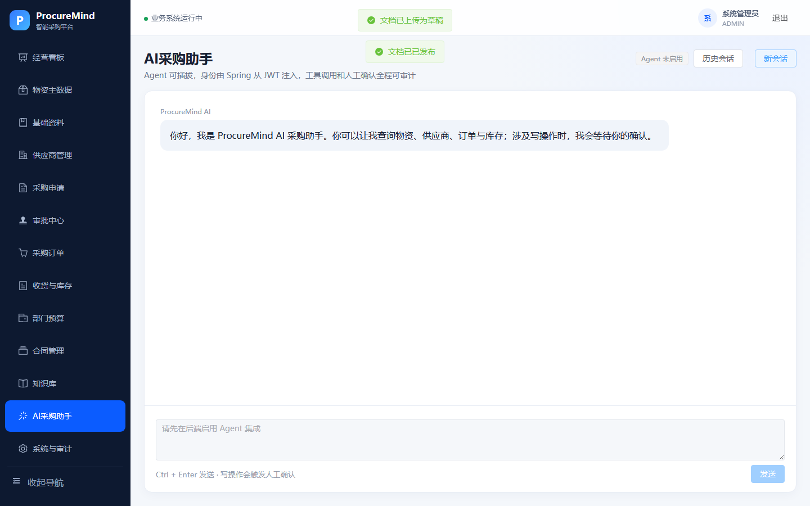
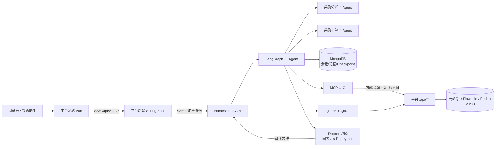
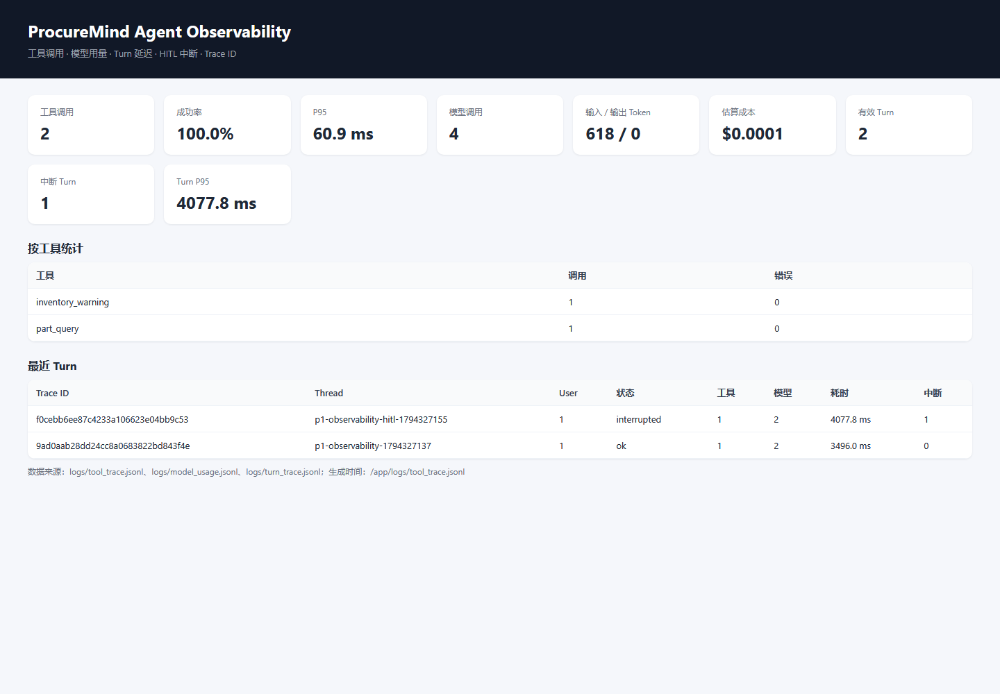

# Procurement Agent Harness

[](https://github.com/q2392044156/procurement-agent-harness/actions/workflows/harness-ci.yml)
[](LICENSE)
[](requirements.txt)

面向制造企业采购业务的 Agent 运行时：**LangGraph + MCP + DeepSeek + bge-m3/Qdrant + MongoDB**。

它不直接连接数据库，而是通过平台内部工具面查询供应商、物资、申请、订单、库存、预算和知识库；平台负责权限、数据范围、审批和幂等，Harness 负责理解、规划、工具调用和结果组织。



## 界面展示

Harness 本身不提供独立管理端，而是作为平台“智能采购助手”的后端运行。

| 智能采购助手 | 知识库问答 |
|---|---|
|  |  |

| 经营看板 | 库存台账 |
|---|---|
|  |  |

## 项目架构



- 浏览器只访问平台，不直接访问 Harness。
- Harness 的每次工具调用都带当前用户身份，权限和数据范围仍由平台判定。
- Harness 不直连 MySQL、MinIO，不转存业务单据。
- 写操作在 Harness 内暂停，等待人工批准后才执行。

### Agent 运行时

```text
用户问题
  → 主 Agent 理解/规划
  → 选择 MCP 工具（查询/分析/写入）
  → 子 Agent 执行复杂任务
  → 评审与结果整理
  → SSE 流式返回平台
```

主图是 `model ↔ tools` 循环；`after_agent` 还有质量评审回路。写工具在 `after_model` 被 HITL 拦截，批准后继续执行，拒绝则不会写入。

## 技术架构

| 层 | 技术 |
|---|---|
| 语言/运行时 | Python 3.12 |
| Web/SSE | FastAPI、Uvicorn |
| Agent | LangChain、LangGraph、deepagents |
| 模型 | DeepSeek（主模型 + 联网搜索模型） |
| 工具协议 | FastMCP、langchain-mcp-adapters |
| 记忆/会话 | MongoDB + LangGraph Checkpointer |
| 向量检索 | bge-m3（1024 维）、Qdrant、BM25 稀疏向量 |
| 沙箱 | Docker（`procuremind-sandbox:latest`：python:3.11-slim + matplotlib/numpy/pandas + Noto CJK 字体），用于图表/文档生成 |
| 业务平台 | Spring Boot 3.5、MySQL 8.4、Redis 7、MinIO、Flowable 7.2 |

## 实现功能

### 业务查询

- 供应商：搜索、分页、详情、资质、绩效评分；
- 物资：编码/名称/品牌/规格模糊搜索、分类筛选；
- 采购申请：分页、详情、审批时间线；
- 采购订单：分页、详情、明细、统计；
- 收货/库存：收货单、余额、流水、预警、盘点、领用记录；
- 审批：待办、已办、审批时间线；
- 预算/合同/仓库/历史成交价；
- 知识库：语义检索、文档原文、引用生成。

### 经营分析

- 供应商记分卡：采购额、订单数、评分、资质到期、平均交付、取消次数；
- 库存风险：安全库存、现存、在途未收，计算净缺口和风险等级；
- 花费分析：部门、供应商、分类、月份；
- 审批 SLA：待办等待时长和超时统计；
- 价格趋势：最新价、均价、最低/最高、涨跌幅。

### 写操作与人工确认

9 个写工具全部经过 HITL：

```text
order_create / order_update / order_submit / order_close / order_cancel
requisition_create / requisition_submit / requisition_cancel / requisition_convert
```

- 执行前中断，等待 `approve` / `reject`；
- 批准后只执行一次，拒绝不落库；
- 平台按“操作 + 用户 + 请求内容”做幂等，重试不会重复建单；
- 中断状态持久化在 MongoDB，进程重启后可以通过同一 `thread_id` 恢复。

### 知识库问答（RAG）

- 20 份采购制度 + 12 份工业物资规范；
- bge-m3 + Qdrant dense/BM25 混合检索 + 精排；
- 检索前按用户可见文档过滤，回答带《文档标题》第 N 页引用；
- 无可靠依据时明确拒答，不用模型常识补答；
- 100 问评测：Top5 **100%**、无关问题拒答 **100%**、Top1 **90%**。

### 记忆与技能

- 三层记忆：HOT 会话、WARM 偏好/近期、COLD 历史归档；
- 用户偏好按用户隔离，支持改口和历史保留；
- 6 个采购技能：供应商分析、比价、库存优化、审批摘要、报告生成、综合分析；
- 技能三级披露：目录 → 正文 → 资源，不一次性读入全部内容。

### 产物与可观测

- 生成图表、Excel/Word 报告；图表与文档先落在沙箱，再由 `download_sandbox_file` 回传到
  `data/download/`，通过 `GET /api/download/<文件名>` 直接预览或下载（图片内联、其余附件）；
- 沙箱镜像预装 matplotlib/numpy/pandas 与 Noto CJK 字体，中文标题不会变方框；
- 每次请求生成 32 位 `trace_id`，记录 Turn 耗时、状态、HITL 中断、工具/模型调用和 token；
- 工具 trace：`trace_id / request_id / thread_id / user_id / tool / 耗时 / 状态`；
- 提供 `/api/observability/summary`、`/turns`、`/threads/{id}`、`/errors` 查询接口；
- 调用次数、成功率、P50/P95、按工具分布、估算成本；
- 生成 HTML 可观测性看板：

```powershell
python -m scripts.dev.observability_report --api http://localhost:8000
```



- 支持联网搜索和网页抓取（外部信息仅作参考）。


## 项目结构

```text
procurement-agent-harness/
├── src/
│   ├── core/                      # 零业务依赖的内核：paths / settings / llm / env / logging / contracts
│   │   ├── settings.py            #   Mongo、MCP、沙箱、Store 命名空间、调用上限、HITL 写工具表
│   │   ├── llm.py                 #   DeepSeek 客户端（关闭 json_schema 能力位，避免 400）
│   │   ├── contracts.py           #   对外契约：ChatRequest / SSEEvent / DisplayMessage …
│   │   └── env.py  logging.py  paths.py
│   ├── server/                    # 传输层：FastAPI 入口、SSE 路由、会话管理
│   │   ├── main.py                #   应用入口（python -m src.server.main）
│   │   ├── settings.py            #   Mongo / 内部令牌等传输层配置
│   │   ├── sessions.py            #   每用户 Agent 实例与运行锁
│   │   └── routes/                #   chat（含 HITL resume）/ history / observability
│   ├── agent/                     # 运行时层：组装 + 编排
│   │   ├── factory.py             #   LLM / 后端 / 工具 / 子 Agent / 中间件组装
│   │   ├── bootstrap.py           #   沙箱冷启动填充（项目 + 基础技能）
│   │   ├── runtime.py             #   请求级上下文（ContextVar）
│   │   ├── review/                #   阶段状态机、评审策略、路由、执行信号 + rubrics.yaml
│   │   ├── skills/                #   技能目录、同步/恢复、安装器、只读工具
│   │   ├── memory/                #   HOT / WARM / COLD 记忆 + 记忆类中间件
│   │   ├── middlewares/           #   用量统计、工具追踪、工具摘要
│   │   ├── prompts/               #   主提示词与 AGENTS.md
│   │   ├── subagents/             #   子 Agent YAML 声明（分析、下单）
│   │   └── tools/                 #   MCP 加载、图表、文档、HITL、联网、沙箱文件
│   ├── sandbox/                   # 容器生命周期：manager / holder / proxy / setup / 健康与熔断
│   ├── observability/             # 单轮 trace 与工具指标
│   ├── infrastructure/            # 跨层适配器：MongoDBStore
│   ├── mcp_server/                # MCP 协议适配：server_main + tools（52 个采购工具）
│   └── kb/                        # RAG：解析、切分、bge-m3、Qdrant、混合检索、引用校验
├── skills/                        # 技能内容（main/ 通用 + procurement/ 采购），拷进沙箱消费
├── tests/                         # pytest 用例（memory skills review sandbox observability kb tools
│                                  #   integration）+ support/ 共享假件 + manual_*.py 手动联调脚本
├── scripts/
│   ├── dev/                       # build-images.ps1 · reset_demo.ps1 · check_imports.py · 观测报告 · 单轮调试
│   ├── seed/                      # 语料生成与知识库入库（kb_ingest / seed_* / generate_*_corpus）
│   ├── smoke/                     # sse_smoke · platform_proxy_smoke · platform_integration_smoke
│   └── verify/                    # S0–S7 阶段门禁（python -m scripts.verify.s0 … s7）
├── evals/                         # business/ review_routing/ live/ rag/ security/
├── docker/sandbox/Dockerfile      # 沙箱镜像：matplotlib / numpy / pandas / Noto CJK 字体
├── data/                          # 运行期产物：download/（回传文件）、kb_state.json、bm25_stats.json（不入库）
├── logs/                          # turn_trace.jsonl 等运行日志（不入库）
├── samples/                       # 制度与工业规范语料
├── docs/                          # ARCHITECTURE / RAG / SKILLS / SECURITY / OBSERVABILITY / STATUS / RESTRUCTURE_PLAN …
│   └── screenshots/               # README 使用的界面截图
├── pyproject.toml                 # pytest 配置（pythonpath / testpaths）
├── Dockerfile                     # agent 与 mcp 共用的镜像
├── requirements.txt
├── .env.example
└── README.md
```

## 快速启动与运行

Harness 依赖同级目录的业务平台：

```text
workspace/
├── smart-procurement-platform/
└── procurement-agent-harness/
```

### 环境要求

- Git
- Docker Desktop / Docker Engine + Docker Compose v2
- 一个可用的 DeepSeek API Key
- 平台仓库位于同级目录
- Python 3.12 + `uv`（仅「本地开发模式」需要；容器模式不需要本机 Python）
- 本机 `3000`、`8080`、`8000`、`8001`、`9000`、`9001`、`6333`、`27017` 端口未被占用
  （`9000/9001` 被占用时，平台 `compose.yml` 的演示覆盖文件会把 MinIO 改到 `9100/9101`）

### 1. 配置环境

#### 平台 `.env`

```powershell
cd ..\smart-procurement-platform
Copy-Item .env.example .env
```

至少配置：

```dotenv
AGENT_ENABLED=true
AGENT_INTERNAL_TOKEN=<至少 32 位随机值>
```

#### Harness `.env`

```powershell
cd ..\procurement-agent-harness
Copy-Item .env.example .env
```

至少配置：

```dotenv
DEEPSEEK_API_KEY=sk-...
AGENT_INTERNAL_TOKEN=<与平台完全一致>
ERP_BASE_URL=http://localhost:8080
MCP_SERVER_URL=http://localhost:8001
MCP_PORT=8001
MONGODB_URI=mongodb://localhost:27017
QDRANT_URL=http://localhost:6333
SANDBOX_IMAGE=procuremind-sandbox:latest
```

> 两个 `.env` 中的 `AGENT_INTERNAL_TOKEN` 必须完全一致；不要提交真实密钥。

### 2. 构建镜像

```powershell
cd ..\procurement-agent-harness
.\scripts\dev\build-images.ps1
```

一次构建两个镜像：

| 镜像 | 用途 |
|---|---|
| `procuremind-agent:latest` | Agent 与 MCP 共用（MCP 不单独出镜像） |
| `procuremind-sandbox:latest` | 沙箱：matplotlib / numpy / pandas + Noto CJK 字体，图表和文档生成要用 |

也可以单独构建沙箱镜像（改图表依赖时只跑这一条即可）：

```powershell
docker build --network=host -t procuremind-sandbox:latest docker/sandbox
```

`docker/sandbox` 用 `--network=host` 是为了绕开默认 bridge 网络下 pip 下载停滞。镜像名由 Harness `.env` 的 `SANDBOX_IMAGE` 指定（默认 `procuremind-sandbox:latest`）；镜像不存在时沙箱会退回 `python:3.11-slim`，此时图表能力不可用。

> 只有 Dockerfile、依赖或源码变化时才需要重新构建；日常启动不要加 `--build`。

### 3. 首次启动

首次启动会清空数据库、重建主数据/知识库，并导入演示业务数据：

```powershell
.\scripts\dev\reset_demo.ps1 -Agent -WithBusiness
```

该命令会：

- 启动 MySQL、Redis、MinIO、后端、前端；
- 启动 Agent、MCP、MongoDB、Qdrant；
- 发布 20 份制度文档和 12 份工业物资规范；
- 重建 Qdrant 索引；
- 导入 120 张采购订单、95 张收货单、48 张领料和库存流水。

> 首次启动会下载 bge-m3，约 2.2GB；可通过 `.env` 配置 `HF_ENDPOINT` 和 `HF_HOME`。
>
> 脚本里的「灌语料 + 重建索引」默认调用 conda 环境 `procurement`（见 `scripts/dev/reset_demo.ps1`）；
> 若改用本机 venv，需要先装好知识库依赖：`sentence-transformers`、`pymupdf`、`rapidocr-onnxruntime`、
> `python-docx` 等（见 `requirements.txt`）。只想启动服务、不重灌数据时加 `-SkipKb`。

### 4. 访问入口

| 入口 | 地址 |
|---|---|
| 平台管理端 / 智能采购助手 | http://localhost:3000 |
| Agent 健康检查 | http://localhost:8000/health |
| Agent API 文档 | http://localhost:8000/docs |
| MCP SSE | http://localhost:8001/sse |
| Qdrant 控制台 | http://localhost:6333/dashboard |
| 平台后端健康检查 | http://localhost:8080/actuator/health |
| MinIO 控制台 | http://localhost:9001（端口冲突时为 9101） |

### 5. 日常启动

首次初始化完成后，日常启动不需要重建镜像：

```powershell
cd ..\smart-procurement-platform
docker compose --profile agent up -d
```

等价的一行命令（会顺带处理 `9000` 端口冲突，并带上演示覆盖文件）：

```powershell
cd ..\smart-procurement-platform
.\scripts\demo-up.ps1 -Agent          # 加 -Build 则先重建镜像；-Down 关闭
```

如果修改了 Harness 代码并重新构建镜像：

```powershell
cd ..\procurement-agent-harness
.\scripts\dev\build-images.ps1

cd ..\smart-procurement-platform
docker compose --profile agent up -d --force-recreate agent mcp
```

### 6. 日常关闭

```powershell
cd ..\smart-procurement-platform
docker compose --profile agent down --remove-orphans
```

说明：

- `down` 会删除容器和网络，保留 MySQL、MinIO、MongoDB、Qdrant 数据卷；
- 下次启动必须用 `up -d`，不要用 `docker compose start`；
- 需要同时清空数据时才执行 `docker compose --profile agent down -v`；
- 只停止前后端、保留基础设施：

```powershell
docker compose stop frontend backend
```

恢复：

```powershell
docker compose start
```

### 7. 本地开发模式（不用容器跑 Harness）

改 Harness 代码时最省事的循环：**基础设施用容器，Agent / MCP 跑在本机进程里**。改完重启进程即可，不必重建镜像。

```powershell
# 1) 只起基础设施
cd ..\smart-procurement-platform
docker compose up -d mysql redis minio mongo qdrant

# 2) 准备本机环境（首次）
cd ..\procurement-agent-harness
uv venv --python 3.12
uv pip install --python .\.venv\Scripts\python.exe -r requirements.txt
Copy-Item .env.example .env      # 填 DEEPSEEK_API_KEY / AGENT_INTERNAL_TOKEN
```

然后开四个终端（都在仓库根下用 `-m` 方式启动，不带 `sys.path` 胶水）：

```powershell
# 终端 1：MCP（先起，Agent 启动时要拉工具清单，:8001）
cd ..\procurement-agent-harness
.\.venv\Scripts\python.exe -m src.mcp_server.server_main

# 终端 2：Agent（:8000）
.\.venv\Scripts\python.exe -m src.server.main

# 终端 3：平台后端（:8080）
cd ..\smart-procurement-platform\backend
mvn spring-boot:run

# 终端 4：平台前端（:3000）
cd ..\smart-procurement-platform\frontend
npm run dev
```

本地模式下两个 `.env` 要指向本机端口：

```dotenv
# harness/.env
ERP_BASE_URL=http://localhost:8080
MCP_SERVER_URL=http://localhost:8001
SANDBOX_IMAGE=procuremind-sandbox:latest
```

```dotenv
# platform/.env
AGENT_ENABLED=true
AGENT_BASE_URL=http://localhost:8000
AGENT_INTERNAL_TOKEN=<与 harness 完全一致>
```

平台后端默认 `AGENT_BASE_URL=http://localhost:8000`，前端 `vite` 开发服务器把 `/api` 代理到 `localhost:8080`，所以按上表配好即可直接联调。

> 沙箱仍然由本机 Docker 提供，所以容器版的沙箱镜像要提前构建好（见第 2 步）。

### 8. 验证与自检

```powershell
cd ..\procurement-agent-harness
$py = '.\.venv\Scripts\python.exe'

# 语法与导入完整性
& $py -m compileall -q src tests scripts evals
& $py -m scripts.dev.check_imports            # import smoke: ok=130 fail=0 / unresolved=0

# 单元测试
& $py -m pytest tests -q                     # 122 passed
& $py -m tests.memory.test_memory_layer      # 34/34
& $py -m tests.kb.test_grounding             # PASS (3 asserts)
```

链路冒烟（需要平台与 Harness 都已启动）：

```powershell
& $py -m scripts.smoke.sse_smoke                  # Agent 直连：问答 + HITL 批准/拒绝
& $py -m scripts.smoke.platform_proxy_smoke       # JWT → Spring → Agent 代理
& $py -m scripts.smoke.platform_integration_smoke # 端到端 15 项：问答 / KB / HITL / 图表回传 / 历史 / 观测
```

手动联调脚本（文件名带 `manual_`，不进 pytest 收集）：

```powershell
& $py -m tests.integration.manual_mcp_check    # MCP 工具直连（52 个工具）
& $py -m tests.integration.manual_all_tools    # 数据模型 / 子 Agent 配置 / 工具清单
```

阶段门禁（S0–S7，逐项对应 `docs/STATUS.md`）：

```powershell
& $py -m scripts.verify.s0    # … s1 … s7
```


## 演示账号

Agent 通过平台登录态识别用户，使用平台的演示账号：

| 角色 | 账号 | 密码 |
|---|---|---|
| 系统管理员 | `admin` | `Admin@123` |
| 申请人 | `requester` | `Request@123` |
| 部门经理 | `manager` | `Manager@123` |
| 采购员 | `purchaser` | `Purchase@123` |
| 财务 | `finance` | `Finance@123` |
| 仓管员 | `warehouse` | `Warehouse@123` |
| 总经理 | `gm` | `Gm@123` |

> 更多扩展角色见平台 README。

### 可以这样问

- “哪些物资低于安全库存？结合在途给我补货清单。”
- “对比三家供应商今年的采购额和评分。”
- “研发部要 5 台笔记本，帮我建申请并提交。”
- “制度里付款账期怎么规定的？”
- “最近三个月轴承价格趋势怎么样？”

## 边界与安全说明

- 本项目是面试展示型 Agent 运行时，不等同于生产级智能体平台。
- 不代替审批、不自动收货、不直接修改库存；9 个写工具全部需要 HITL。
- 不直连业务数据库，不持有超级权限；权限和数据范围由平台最终裁决。
- 内部工具面只接受 `X-Internal-Token`，并透传 `X-User-Id`；`/api/**` 不通过 Nginx 对外暴露。
- 不把业务单据缓存进长期记忆，只保存偏好与摘要。
- 知识库只返回已发布且当前用户可见的文档。
- 联网搜索结果是外部低信任数据，不覆盖平台权限、审批和制度约束。
- 演示密码、`DEEPSEEK_API_KEY`、`AGENT_INTERNAL_TOKEN` 仅用于本地；部署前必须更换。
- 不要将 `8000`、`8001`、`27017`、`6333` 直接暴露到公网。

### 安全评测

```powershell
cd ..\procurement-agent-harness
.\.venv\Scripts\python.exe -m evals.security.run
```

覆盖 10 类攻击面：内部 API 鉴权、角色提升、IDOR、批量删除/清库存、Prompt 注入写单、系统提示词/密钥提取、知识库 ACL、知识库间接注入、SQL 注入、HITL 拒绝不落库。当前 **10/10 PASS**，详见 [docs/SECURITY_EVAL.md](docs/SECURITY_EVAL.md)。

### 明确不支持

- 代替审批、自动收货、直接改库存；
- 发票、三单匹配、质检/退货；
- 批量写单；
- 未发布或无权限文档的问答；
- 复杂扫描件版式还原和跨页表格结构化。

## License

本项目采用 [MIT License](LICENSE)，Copyright (c) 2026 WangQF。
