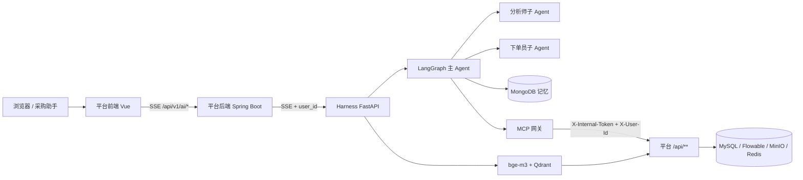

# Procurement Agent Harness

[](https://github.com/q2392044156/procurement-agent-harness/actions/workflows/harness-ci.yml)
[](LICENSE)
[](requirements.txt)

> 面向采购业务的 Agent 运行时：**LangGraph + MCP + DeepSeek + bge-m3/Qdrant + MongoDB**。
> 与业务平台 [`smart-procurement-platform`](../smart-procurement-platform) 通过内部工具契约解耦：
> 平台负责权限、数据范围、审批与幂等，Harness 负责理解、编排与工具调用。

---

## 1. 项目是什么

这是一个**能真实操作采购业务的智能助手**，不是聊天 Demo：

- 业务底座是同级目录的 Java 平台（采购申请 → 审批 → 订单 → 收货 → 库存 → 预算 → 合同 → 知识库）；
- Harness 不直连数据库、不绕过权限，所有读写都经过平台 `/api/**` 内部工具面；
- 每次工具调用都携带当前用户身份，平台按角色与数据范围裁决；
- 写操作必须人工确认（HITL），平台按请求内容幂等，重试不会重复建单。

典型链路：



---

## 2. 能做什么

### 2.1 业务查询（51 个 MCP 工具）

| 领域 | 能力 |
|---|---|
| 供应商 | 搜索、分页、详情、创建、状态变更、记分卡 |
| 物资 | 搜索、分页、详情、按供应商查询、创建 |
| 采购申请 | 分页、详情、创建、提交、取消、转订单 |
| 采购订单 | 分页、详情、明细检索、统计、创建、修改、提交、取消 |
| 收货 / 库存 | 收货单、库存余额、流水、预警、盘点、出库/领用记录 |
| 审批 | 待办、已办、时间线、看板、提醒 |
| 运营 | 仓库、预算、合同、历史成交价 |
| 分析 | 库存风险、花费分析、审批 SLA、价格趋势 |
| 知识库 | 语义检索、文档下载地址、引用生成 |

### 2.2 经营分析

- 供应商记分卡：年度采购额、订单数、评分、资质到期、平均交付天数、取消次数；
- 库存风险：净缺口 = `max(安全库存 − 现存 − 在途未收, 0)`，输出 HIGH/COVERED/LOW；
- 花费分析：按部门 / 供应商 / 分类 / 月份；
- 审批 SLA：待办等待时长与超时统计；
- 价格趋势：最新价、均价、最低/最高、涨跌幅。

### 2.3 写操作（全部 HITL + 幂等）

| 工具 | 说明 |
|---|---|
| `requisition_create` | 创建采购申请草稿 |
| `requisition_submit` | 提交审批 |
| `requisition_cancel` | 取消申请 |
| `requisition_convert` | 已批准申请转订单 |
| `order_create` / `order_update` | 创建/修改直采订单 |
| `order_cancel` | 取消订单 |

- 每个写操作都会中断等待人工 `approve / reject`；
- 平台按「操作 + 用户 + 请求内容」去重，并回读校验结果。

### 2.4 知识库问答（RAG）

- 20 份制度文档 + 12 份工业物资规范，bge-m3（1024 维）+ Qdrant，dense+BM25 混合检索；
- 检索前按 `visible-doc-ids` 过滤，回答带 `《标题》第N页` 引用；
- 无依据时返回空结果，明确拒答；
- 增量同步：`changed?since` + 每文档版本去重。

**50 问评测**：Top5 命中 **100%**、关键词命中 **100%**、无关问题拒答 **100%**，Top1 86.7%。

### 2.5 记忆与技能

- 三层记忆：HOT（会话）、WARM（偏好/近期）、COLD（历史/过期）；
- 偏好支持改口并保留历史，按用户隔离；
- 6 个采购技能：供应商分析、比价、库存优化、审批摘要、报告生成、综合分析；
- 技能三级披露：目录 → 正文 → 资源，不预读全部正文。

### 2.6 产物与可观测

- 图表（matplotlib）、Excel/Word 报告（沙箱生成）；
- 工具调用 trace：`request_id / thread_id / user_id / tool / 耗时 / 状态`；
- 指标：调用数、成功率、P50/P95、按工具分布；
- 阶段门禁 S0–S7 + 真机评测 + RAG 评测。

---

## 3. 技术栈

| 层 | 技术 | 版本 |
|---|---|---|
| 语言 | Python | 3.12 |
| Web/SSE | FastAPI + Uvicorn + sse-starlette | 0.162 / 0.54 / 3.7 |
| Agent | LangChain + LangGraph + deepagents | 1.4.9 / 1.2.20 / 0.7.34 |
| 模型 | DeepSeek `deepseek-flash`（主）/ `deepseek-v4-pro`（联网搜索） | — |
| 模型接入 | langchain-deepseek | 1.1.1 |
| 工具协议 | FastMCP + langchain-mcp-adapters | 3.4.11 / 0.3.2 |
| 记忆 | MongoDB 8 + pymongo/motor + langgraph-checkpoint-mongodb | 4.19 |
| 向量库 | Qdrant | 1.20 客户端 |
| Embedding | BAAI/bge-m3（sentence-transformers + torch CPU） | 6.2 / 2.15 |
| 文档解析 | pypdf + python-docx | 7.0 / 1.2 |
| 图表/表格 | matplotlib + pandas | 3.11 / 3.1 |
| 沙箱 | Docker SDK（python:3.11-slim） | 7.x |

平台侧依赖：Java 21、Spring Boot 3.5、Flowable 7.2、MySQL 8.4、Redis 7、MinIO、Vue 3。

---

## 4. 目录结构

```text
procurement-agent-harness/
├── src/
│   ├── agent/                # 主 Agent、子 Agent、中间件、记忆、提示词、工具
│   │   ├── main_agent.py     # 组装 LLM / 工具 / 子 Agent / 中间件
│   │   ├── harness.py        # 阶段状态机 + rubric 评审
│   │   ├── prompts/          # 系统提示词与 AGENTS.md
│   │   ├── memory/           # HOT/WARM/COLD 三层记忆
│   │   ├── middlewares/      # 上下文、记忆、沙箱、追踪
│   │   ├── subagents/        # YAML 声明的子 Agent
│   │   └── tools/            # MCP 客户端、图表、文档、联网搜索
│   ├── mcp_server/           # MCP Server 与 52 个工具
│   ├── kb/                   # RAG：解析、切分、bge-m3、Qdrant、检索
│   ├── api_view/             # FastAPI + SSE + 历史会话
│   ├── infra/                # MongoDBStore 等跨层适配器
│   ├── skills/               # 采购技能（SKILL.md）
│   └── test/                 # 单元/集成测试
├── scripts/                  # 阶段门禁、评测、语料、入库
├── evals/                    # 业务评测与真机评测结果
├── samples/kb_corpus/        # 评测语料生成器与标注
├── docs/                     # 架构、RAG、技能、可观测、状态
├── data/                     # 运行期下载文件（忽略）
├── Dockerfile
├── requirements.txt
├── .env.example
└── README.md
```

---

## 5. 快速开始

以下为**已实测可用**的本地运行方式（平台 Docker + Harness conda 进程）。

### 5.1 前置条件

- Docker Desktop（Compose v2）已启动；
- Conda（Python 3.12）；
- 平台仓库位于同级目录 `../smart-procurement-platform`；
- 一个可用的 DeepSeek API Key。

### 5.2 启动平台

```powershell
cd ..\smart-procurement-platform
# 首次会生成 .env，请修改密钥
.\scripts\demo-up.ps1 -Build
```

确认 <http://localhost:8080/actuator/health> 返回 `UP`，前端 <http://localhost:3000> 可登录。

### 5.3 配置 Harness

```powershell
cd ..\procurement-agent-harness
Copy-Item .env.example .env
```

编辑 `.env`，至少填写：

```dotenv
DEEPSEEK_API_KEY=sk-...
AGENT_INTERNAL_TOKEN=<与平台一致，>=32 位>
ERP_BASE_URL=http://localhost:8080
MCP_SERVER_URL=http://localhost:8001
MCP_PORT=8001
MONGODB_URI=mongodb://localhost:27017
QDRANT_URL=http://localhost:6333
```

平台 `.env` 需要：

```dotenv
AGENT_ENABLED=true
AGENT_INTERNAL_TOKEN=同一个值
# 若 Agent 跑在宿主机、平台在 Docker 内：
AGENT_BASE_URL=http://host.docker.internal:8000
```

改完重启平台后端：

```powershell
cd ..\smart-procurement-platform
docker compose up -d backend
```

### 5.4 安装依赖

```powershell
conda create -n procurement python=3.12 -y
conda activate procurement
# 国内网络先装 CPU 版 torch，避免 CUDA 依赖
pip install --index-url https://download.pytorch.org/whl/cpu torch
pip install -r requirements.txt
```

### 5.5 启动 Qdrant

```powershell
docker run -d --name procuremind-qdrant -p 6333:6333 `
  -v procuremind-qdrant-data:/qdrant/storage qdrant/qdrant:latest
```

### 5.6 启动 MCP 与 Agent

```powershell
# 终端 A：MCP（:8001）
conda activate procurement
python -m src.mcp_server.server_main

# 终端 B：Agent API（:8000）
conda activate procurement
python -m src.api_view.web_main
```

健康检查：

```powershell
curl -N --max-time 3 http://localhost:8001/sse   # 能收到 SSE 事件即正常
curl http://localhost:8000/health
```

### 5.7 初始化知识库

```powershell
conda activate procurement
python scripts/seed_kb_documents.py   # 上传并发布 20 份制度文档
python scripts/generate_industrial_corpus.py
python scripts/seed_industrial_kb.py  # 上传 12 份工业物资规范
python scripts/kb_ingest.py           # 解析、bge-m3 向量化、写入 Qdrant
```

首次运行会下载 bge-m3（约 2.2GB）。国内网络可在 `.env` 设置：

```dotenv
HF_ENDPOINT=https://hf-mirror.com
HF_HOME=E:\data\hf
```

### 5.8 使用

打开 <http://localhost:3000>，进入 **AI 采购助手**，例如：

- “哪些物资低于安全库存？结合在途给补货清单”
- “对比三家供应商今年的采购额和评分”
- “研发部要 5 台笔记本，帮我建申请并提交”
- “制度里付款账期怎么规定的？”

### 5.9 Docker 方式（可选）

首次构建必须使用 **host 网络**，否则 209MB 的 CPU torch 在 Docker 默认网络下容易长时间停滞：

```powershell
cd ..\procurement-agent-harness
.\scripts\build-images.ps1

cd ..\smart-procurement-platform
.\scripts\demo-up.ps1 -Agent
```

首次在 MCP/Agent 容器内需要执行一次入库：

```powershell
docker compose --profile agent exec mcp python -c "from src.kb.sync import sync; print(sync('1'))"
```

> compose 的 `build` 不支持 `network: host` 权限，所以先用脚本构建镜像，再 `up` 复用镜像。
> bge-m3 模型会缓存在 `hf-cache` 卷；若宿主机已下载，可先复制进卷避免重复下载。

---

## 6. 配置说明（`.env`）

| 变量 | 必填 | 默认 | 说明 |
|---|---|---|---|
| `DEEPSEEK_API_KEY` | ✅ | — | 主模型、评审、联网搜索共用 |
| `LLM_MODEL` | | `deepseek-flash` | 主模型 |
| `LLM_THINKING` | | `false` | 工具调用时关闭思考，避免 `reasoning_content` 回传 400 |
| `LLM_MAX_TOKENS` | | `4096` | 单次输出上限 |
| `WEB_SEARCH_MODEL` | | `deepseek-v4-pro` | Responses API 的 `web_search` 仅 v4-pro 支持 |
| `ERP_BASE_URL` | ✅ | `http://localhost:8080` | 本地平台地址；容器内为 `http://backend:8080` |
| `MCP_SERVER_URL` | ✅ | `http://localhost:8001` | MCP SSE 地址 |
| `MCP_PORT` | | `9000` | **本地务必设为 8001**，与上面一致 |
| `AGENT_INTERNAL_TOKEN` | ✅ | — | 与平台共享，≥32 位 |
| `MONGODB_URI` / `MONGODB_DB_NAME` | | `localhost:27017` / `erp_agent` | 记忆与会话 |
| `QDRANT_URL` | | `http://localhost:6333` | 容器内为 `http://qdrant:6333` |
| `KB_COLLECTION` | | `procurement_kb` | Qdrant 集合 |
| `KB_EMBEDDING_MODEL` | | `BAAI/bge-m3` | 改模型需重建集合 |
| `KB_MIN_SCORE` | | `0.40` | 拒答阈值（按语料标定） |
| `HF_ENDPOINT` | | `https://hf-mirror.com` | 模型下载镜像 |
| `MEMORY_*` | | 见示例 | 记忆 TTL / 条数 / 工具开关 |
| `TOOL_TRACE_FILE` | | `logs/tool_trace.jsonl` | 工具追踪输出 |

> `.env` 已被 `.gitignore` 忽略，**不要提交**；`.env.example` 只保留空值。

---

## 7. 评测与门禁

```powershell
conda activate procurement

# 阶段门禁
python scripts/verify_phase_s0.py   # 真机只读链路      9/9
python scripts/verify_phase_s1.py   # 运营只读工具     14/14
python scripts/verify_phase_s2.py   # 分析能力          7/7
python scripts/verify_phase_s3.py   # 写入 + 幂等      10/10
python scripts/verify_phase_s4.py   # RAG               8/8
python scripts/verify_phase_s6.py   # 真机评测 + 追踪    6/6
python scripts/verify_phase_s7.py   # 部署编排          7/7（宿主运行态）

# 评测
python scripts/eval_live.py         # 10 个真机场景
python scripts/eval_rag.py          # 45 问 + 5 无关问题
python scripts/live_agent_turn.py   # 真实 LLM 单轮

# 单元测试
python -m src.test.test_memory_layer        # 34/34
python -m src.test.test_progressive_skills  # 19（Windows 符号链接用例自动跳过）
```

当前结果：真机 10/10、RAG Top5 100%、拒答 100%、工具成功率 100%、P95 约 97ms。

---

## 8. 安全与边界

- 内部工具面只接受 `X-Internal-Token`，Nginx 对 `/api/` 固定 404；
- 每个请求透传 `X-User-Id`，权限与数据范围由平台判定；
- 写操作全部 HITL，不提供“代审批”工具；
- 不直连 MySQL / MinIO，不转存业务数据；
- 不缓存业务单据到记忆，只保存偏好与摘要。

### 明确不支持

- 代替审批、自动收货、直接改库存；
- 发票 / 三单匹配、质检 / 退货；
- 批量写单；
- 未发布或无权限文档的问答；
- 扫描件 OCR、rerank 模型（当前仅分数阈值）。

---

## 9. 已知限制

1. **容器镜像构建受网络影响**：Docker 内下载 torch 可能很慢，Dockerfile 已改为 CPU wheel + 国内镜像；建议在稳定网络或 CI 构建。
2. **平台前端 → Agent 的 SSE 代理**代码已对齐，但容器化 agent/mcp 未在本机完成端到端启动验证；宿主进程方式已验证同一拓扑。
3. **RAG 语料**为 2 份真实示例 + 18 份评测语料，长文档跨切片召回尚未覆盖。
4. **模型随机性**：评测用确定性断言 + 阈值，不保证每次回答逐字一致。

---

## 10. 文档索引

| 文档 | 内容 |
|---|---|
| [docs/RAG.md](docs/RAG.md) | 入库、检索、可见性、阈值标定 |
| [docs/SKILLS.md](docs/SKILLS.md) | 三层记忆与 6 个技能 |
| [docs/OBSERVABILITY.md](docs/OBSERVABILITY.md) | 工具追踪、指标、真机评测 |
| [docs/STATUS.md](docs/STATUS.md) | S0–S7 结果与剩余工作 |
| [docs/IMPLEMENTATION_PLAN.md](docs/IMPLEMENTATION_PLAN.md) | 完整实施计划 |
| [docs/EVAL_RAG.md](docs/EVAL_RAG.md) | 50 问 RAG 评测报告 |

---

## 11. 许可

本项目采用 [MIT License](LICENSE)，Copyright (c) 2026 WangQF。
