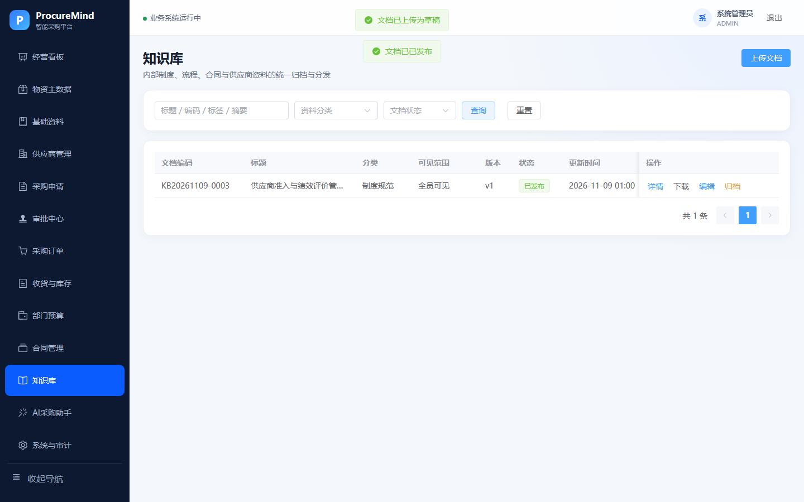
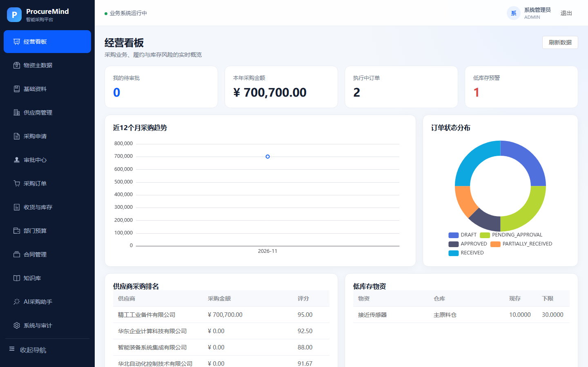
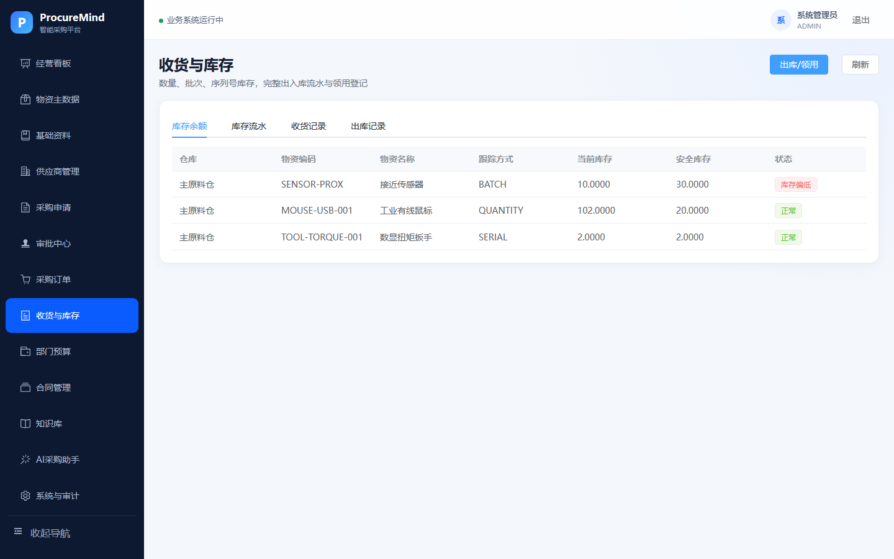
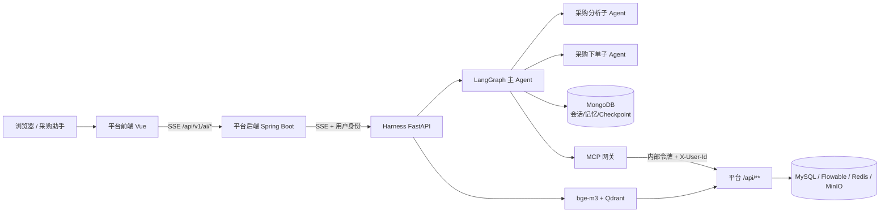

# Procurement Agent Harness

[](https://github.com/q2392044156/procurement-agent-harness/actions/workflows/harness-ci.yml)
[](LICENSE)
[](requirements.txt)

面向制造企业采购业务的 Agent 运行时：**LangGraph + MCP + DeepSeek + bge-m3/Qdrant + MongoDB**。

它不直接连接数据库，而是通过平台内部工具面查询供应商、物资、申请、订单、库存、预算和知识库；平台负责权限、数据范围、审批和幂等，Harness 负责理解、规划、工具调用和结果组织。


## 界面展示

Harness 本身不提供独立管理端，而是作为平台“智能采购助手”的后端运行。

| 智能采购助手 | 知识库问答 |
|---|---|
|  |  |

| 经营看板 | 库存台账 |
|---|---|
|  |  |

## 项目架构



- 浏览器只访问平台，不直接访问 Harness。
- Harness 的每次工具调用都带当前用户身份，权限和数据范围仍由平台判定。
- Harness 不直连 MySQL、MinIO，不转存业务单据。
- 写操作在 Harness 内暂停，等待人工批准后才执行。

### Agent 运行时

```text
用户问题
  → 主 Agent 理解/规划
  → 选择 MCP 工具（查询/分析/写入）
  → 子 Agent 执行复杂任务
  → 评审与结果整理
  → SSE 流式返回平台
```

主图是 `model ↔ tools` 循环；`after_agent` 还有质量评审回路。写工具在 `after_model` 被 HITL 拦截，批准后继续执行，拒绝则不会写入。

## 技术架构

| 层 | 技术 |
|---|---|
| 语言/运行时 | Python 3.12 |
| Web/SSE | FastAPI、Uvicorn |
| Agent | LangChain、LangGraph、deepagents |
| 模型 | DeepSeek（主模型 + 联网搜索模型） |
| 工具协议 | FastMCP、langchain-mcp-adapters |
| 记忆/会话 | MongoDB + LangGraph Checkpointer |
| 向量检索 | bge-m3（1024 维）、Qdrant、BM25 稀疏向量 |
| 沙箱 | Docker（python:3.11-slim），用于图表/文档生成 |
| 业务平台 | Spring Boot 3.5、MySQL 8.4、Redis 7、MinIO、Flowable 7.2 |

## 实现功能

### 业务查询

- 供应商：搜索、分页、详情、资质、绩效评分；
- 物资：编码/名称/品牌/规格模糊搜索、分类筛选；
- 采购申请：分页、详情、审批时间线；
- 采购订单：分页、详情、明细、统计；
- 收货/库存：收货单、余额、流水、预警、盘点、领用记录；
- 审批：待办、已办、审批时间线；
- 预算/合同/仓库/历史成交价；
- 知识库：语义检索、文档原文、引用生成。

### 经营分析

- 供应商记分卡：采购额、订单数、评分、资质到期、平均交付、取消次数；
- 库存风险：安全库存、现存、在途未收，计算净缺口和风险等级；
- 花费分析：部门、供应商、分类、月份；
- 审批 SLA：待办等待时长和超时统计；
- 价格趋势：最新价、均价、最低/最高、涨跌幅。

### 写操作与人工确认

9 个写工具全部经过 HITL：

```text
order_create / order_update / order_submit / order_close / order_cancel
requisition_create / requisition_submit / requisition_cancel / requisition_convert
```

- 执行前中断，等待 `approve` / `reject`；
- 批准后只执行一次，拒绝不落库；
- 平台按“操作 + 用户 + 请求内容”做幂等，重试不会重复建单；
- 中断状态持久化在 MongoDB，进程重启后可以通过同一 `thread_id` 恢复。

### 知识库问答（RAG）

- 20 份采购制度 + 12 份工业物资规范；
- bge-m3 + Qdrant dense/BM25 混合检索 + 精排；
- 检索前按用户可见文档过滤，回答带《文档标题》第 N 页引用；
- 无可靠依据时明确拒答，不用模型常识补答；
- 100 问评测：Top5 **100%**、无关问题拒答 **100%**、Top1 **90%**。

### 记忆与技能

- 三层记忆：HOT 会话、WARM 偏好/近期、COLD 历史归档；
- 用户偏好按用户隔离，支持改口和历史保留；
- 6 个采购技能：供应商分析、比价、库存优化、审批摘要、报告生成、综合分析；
- 技能三级披露：目录 → 正文 → 资源，不一次性读入全部内容。

### 产物与可观测

- 生成图表、Excel/Word 报告；
- 工具 trace：`request_id / thread_id / user_id / tool / 耗时 / 状态`；
- 调用次数、成功率、P50/P95、按工具分布；
- 支持联网搜索和网页抓取（外部信息仅作参考）。

## 项目结构

```text
procurement-agent-harness/
├── src/
│   ├── agent/
│   │   ├── main_agent.py          # LLM / 工具 / 子 Agent / 中间件组装
│   │   ├── harness.py             # 阶段状态机与 rubric 评审
│   │   ├── prompts/               # 主提示词与 AGENTS.md
│   │   ├── memory/                # HOT / WARM / COLD 记忆
│   │   ├── middlewares/           # 上下文、记忆、沙箱、追踪、HITL
│   │   ├── subagents/             # 分析、下单两个子 Agent
│   │   └── tools/                 # MCP 客户端、图表、文档、联网搜索
│   ├── mcp_server/
│   │   ├── server_main.py         # MCP SSE 服务
│   │   └── tools/                 # 52 个采购工具
│   ├── kb/                        # 解析、切分、bge-m3、Qdrant、检索
│   ├── api_view/                  # FastAPI、SSE、会话、HITL resume
│   ├── infra/                     # MongoDB Store 等适配器
│   ├── skills/                    # 采购技能
│   └── test/                      # 单元/集成测试
├── scripts/                       # 语料、入库、启动、门禁、评测
├── samples/                       # 制度与工业规范语料
├── docs/
│   ├── screenshots/               # README 使用的界面截图
│   ├── ARCHITECTURE.md
│   ├── RAG.md
│   ├── SKILLS.md
│   └── SECURITY.md
├── Dockerfile
├── requirements.txt
├── .env.example
└── README.md
```

## 完整启动与关闭

Harness 依赖同级目录的业务平台：

```text
workspace/
├── smart-procurement-platform/
└── procurement-agent-harness/
```

### 前置条件

- Git
- Docker Desktop / Docker Engine + Docker Compose v2
- 一个可用的 DeepSeek API Key
- 平台仓库位于同级目录

### 1. 准备平台

```powershell
cd ..\smart-procurement-platform
Copy-Item .env.example .env
```

编辑平台 `.env`：

```dotenv
AGENT_ENABLED=true
AGENT_INTERNAL_TOKEN=<至少 32 位随机值>
```

### 2. 准备 Harness

```powershell
cd ..\procurement-agent-harness
Copy-Item .env.example .env
```

编辑 `.env`：

```dotenv
DEEPSEEK_API_KEY=sk-...
AGENT_INTERNAL_TOKEN=<与平台完全一致>
ERP_BASE_URL=http://localhost:8080
MCP_SERVER_URL=http://localhost:8001
MCP_PORT=8001
MONGODB_URI=mongodb://localhost:27017
QDRANT_URL=http://localhost:6333
```

### 3. 构建镜像

```powershell
.\scripts\build-images.ps1
```

### 4. 启动完整环境

推荐直接清库、重建主数据/知识库，并导入 12 个月业务演示数据：

```powershell
.\scripts\reset_demo.ps1 -Agent -WithBusiness
```

该命令会：

- 启动 MySQL、Redis、MinIO、后端、前端；
- 启动 Agent、MCP、MongoDB、Qdrant；
- 发布 20 份制度文档和 12 份工业物资规范；
- 重建 Qdrant 索引；
- 导入 120 张采购订单、95 张收货单、48 张领料和库存流水。

如果只想启动、不重置数据：

```powershell
cd ..\smart-procurement-platform
.\scripts\demo-up.ps1 -Agent
```

首次启动会下载 bge-m3，约 2.2GB；可通过 `.env` 配置 `HF_ENDPOINT` 和 `HF_HOME`。

### 5. 访问入口

| 入口 | 地址 |
|---|---|
| 平台管理端 / 智能采购助手 | http://localhost:3000 |
| Agent 健康检查 | http://localhost:8000/health |
| Agent API 文档 | http://localhost:8000/docs |
| MCP SSE | http://localhost:8001/sse |
| Qdrant 控制台 | http://localhost:6333/dashboard |
| 平台后端健康检查 | http://localhost:8080/actuator/health |
| MinIO 控制台 | http://localhost:9001（端口冲突时为 9101） |

### 6. 关闭

```powershell
cd ..\smart-procurement-platform
docker compose --profile agent down
```

保留数据卷；如果确认清空全部数据：

```powershell
docker compose --profile agent down -v
```

只停止前后端、保留基础设施：

```powershell
docker compose stop frontend backend
```

恢复：

```powershell
docker compose start
```

### 宿主进程方式（调试用）

如果不想把 Harness 放进容器：

```powershell
# 1. 平台只启动基础设施和业务服务
cd ..\smart-procurement-platform
docker compose up -d mysql redis minio backend frontend

# 2. 启动 Qdrant / MongoDB
docker compose --profile agent up -d mongo qdrant

# 3. 安装 Harness 依赖
cd ..\procurement-agent-harness
conda create -n procurement python=3.12 -y
conda activate procurement
pip install --index-url https://download.pytorch.org/whl/cpu torch
pip install -r requirements.txt

# 4. 终端 A：MCP
python -m src.mcp_server.server_main

# 5. 终端 B：Agent API
python -m src.api_view.web_main
```

平台 `.env` 需要：

```dotenv
AGENT_ENABLED=true
AGENT_BASE_URL=http://host.docker.internal:8000
```

关闭：两个终端按 `Ctrl+C`，再回到平台执行 `docker compose down`。

## 演示账号

Agent 通过平台登录态识别用户，使用平台的演示账号：

| 角色 | 账号 | 密码 |
|---|---|---|
| 系统管理员 | `admin` | `Admin@123` |
| 申请人 | `requester` | `Request@123` |
| 部门经理 | `manager` | `Manager@123` |
| 采购员 | `purchaser` | `Purchase@123` |
| 财务 | `finance` | `Finance@123` |
| 仓管员 | `warehouse` | `Warehouse@123` |
| 总经理 | `gm` | `Gm@123` |

> 更多扩展角色见平台 README。

### 可以这样问

- “哪些物资低于安全库存？结合在途给我补货清单。”
- “对比三家供应商今年的采购额和评分。”
- “研发部要 5 台笔记本，帮我建申请并提交。”
- “制度里付款账期怎么规定的？”
- “最近三个月轴承价格趋势怎么样？”

## 边界与安全说明

- 本项目是面试展示型 Agent 运行时，不等同于生产级智能体平台。
- 不代替审批、不自动收货、不直接修改库存；9 个写工具全部需要 HITL。
- 不直连业务数据库，不持有超级权限；权限和数据范围由平台最终裁决。
- 内部工具面只接受 `X-Internal-Token`，并透传 `X-User-Id`；`/api/**` 不通过 Nginx 对外暴露。
- 不把业务单据缓存进长期记忆，只保存偏好与摘要。
- 知识库只返回已发布且当前用户可见的文档。
- 联网搜索结果是外部低信任数据，不覆盖平台权限、审批和制度约束。
- 演示密码、`DEEPSEEK_API_KEY`、`AGENT_INTERNAL_TOKEN` 仅用于本地；部署前必须更换。
- 不要将 `8000`、`8001`、`27017`、`6333` 直接暴露到公网。

### 明确不支持

- 代替审批、自动收货、直接改库存；
- 发票、三单匹配、质检/退货；
- 批量写单；
- 未发布或无权限文档的问答；
- 复杂扫描件版式还原和跨页表格结构化。

## License

本项目采用 [MIT License](LICENSE)，Copyright (c) 2026 WangQF。
