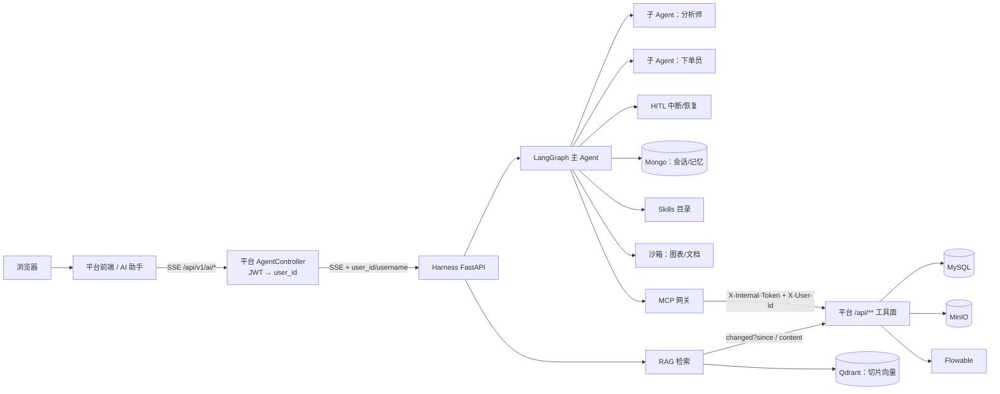

# Harness 系统实现计划

> 目标仓库：`E:\project\my_project2\procurement-agent-harness`
> 业务底座：`E:\project\my_project2\smart-procurement-platform`（已提供内部工具契约与知识库检索接口）
> 计划口径：单人全职，6–7 周；每个阶段都有可验收产出，不是“最后一起联调”。

---

## 0. 目标与非目标

### 目标

交付一个**可真实操作采购业务的 Agent 系统**：

1. 自然语言完成：查库存、查供应商、做对比分析、生成采购建议、创建并提交采购申请、转订单、跟踪审批；
2. 内部文档问答：基于平台知识库做带引用的检索问答（RAG）；
3. 所有写操作经过人工确认（HITL），失败可解释、可重试、不重复；
4. 全链路可观测：每次工具调用可追溯到用户、请求、耗时、结果；
5. 可部署：`docker compose --profile agent up` 一条命令起全栈；
6. 可评测：业务场景集 + 引用正确率 + 工具调用成功率。

### 非目标（本计划不做）

- 重写平台业务逻辑；供应商门户；多租户；移动端；
- 模型训练/微调；替代平台审批规则；
- 让 Agent 直接操作数据库或对象存储（必须经平台接口）。

---

## 1. 现状评估

### 1.1 平台已具备（可直接依赖）

| 能力 | 位置 | 状态 |
|---|---|---|
| 内部工具契约 | `docs/AGENT_TOOL_CONTRACT.md` | ✅ 认证、权限映射、状态枚举、错误码、幂等、分页 |
| 档案/单据读写 | `/api/suppliers|parts|orders|inventory/**` | ✅ 订单创建/修改幂等 |
| 只读工具面 | `/api/requisitions|workflow|receipts|dashboard|alerts/**` | ✅ |
| 知识库检索 | `/api/kb/visible-doc-ids|documents/changed|documents/{id}/content` | ✅ 可见性前置过滤 |
| SSE 代理 | `AgentController` + 前端 `AssistantView` | ✅ 事件名已对齐 |
| 验收脚本 | P0/P1/P2/知识库/核心闭环 | ✅ 可作为 harness 集成测试的对端 |

### 1.2 Harness 已有能力

- 主 Agent（LangGraph/DeepAgent）、两个子 Agent（analyst / order）、记忆三层（HOT/WARM/COLD）、技能渐进披露、审查路由、HITL、沙箱、SSE API、Mongo 会话、评测框架。
- 4 组 MCP 工具：`suppliers`、`parts`、`orders`、`inventory`。

### 1.3 硬缺口（按阻塞程度排序）

| # | 缺口 | 影响 | 证据 |
|---|---|---|---|
| 1 | `.env` 指向 `8081`/`9000`，且无 `AGENT_INTERNAL_TOKEN` | 连不上真平台，MCP 调平台必 401 | `.env.example` |
| 2 | 评测用 `patch(erp_client, ERP())` 内存夹具 | 从未验证真实平台 | `evals/business/run.py` |
| 3 | 工具面缺：申请创建/提交/转单、预算、合同、出库、提醒、货位 | Agent 走不了平台核心闭环 | 对照契约端点 |
| 4 | 无 RAG：无切片、无向量、无重排 | 文档问答不可用 | 无 `kb/` 模块、无向量库依赖 |
| 5 | 无平台级集成测试 | 回归靠手工 | `src/test/` 无真实后端用例 |
| 6 | 无工具调用级 trace/指标 | 线上问题无法定位 | 仅连接级 `X-Request-Id` |
| 7 | 无统一错误策略 | 模型会重试 409，放大失败 | 契约已定义，harness 未落地 |

---

## 2. 目标架构



### 2.1 身份链路（唯一真相）

```
平台 JWT → AgentController 注入 user_id/username
        → Harness 会话绑定 user_id
        → MCP 请求头 X-User-Id + X-Internal-Token
        → 平台过滤器加载权限 + 数据范围
        → 业务 Service 做最终判定
```

Agent **不持有**超级权限；越权测试必须成为每个阶段的回归项。

### 2.2 存储职责

| 数据 | 存放 | 说明 |
|---|---|---|
| 业务单据/库存/权限 | 平台 MySQL | 唯一业务真相，harness 不落库 |
| 文件原文 | 平台 MinIO | harness 只经平台预签名取用 |
| 会话/消息/记忆 | Harness MongoDB | 可丢失，不影响业务 |
| 文档切片/向量 | Harness Qdrant | 可重建，不入平台 |

---

## 3. 工具面设计（目标 ~28 个工具）

### 3.1 只读：档案与主数据（6）

| 工具 | 平台端点 | 备注 |
|---|---|---|
| `supplier_search` / `supplier_page` / `supplier_get` | `/api/suppliers/search|page|get/{id}` | 已有，补 `lifecycleStatus` 说明 |
| `part_search` / `part_page` | `/api/parts/search|page` | 已有 |
| `masterdata_lookup` | 新增 `/api/warehouses`（只读） | 出库/库存解读需要仓库 ID |

### 3.2 只读：单据与流程（7）

| 工具 | 平台端点 |
|---|---|
| `requisition_page` / `requisition_get` | `/api/requisitions/page|get/{id}` |
| `order_page` / `order_get` | `/api/orders/page|get/{id}` |
| `receipt_page` | `/api/receipts/page` |
| `workflow_todo` | `/api/workflow/todo` |
| `workflow_timeline` | `/api/workflow/timeline/{type}/{id}` |

### 3.3 经营与分析（6）

| 工具 | 数据来源 | 说明 |
|---|---|---|
| `dashboard_summary` | `/api/dashboard/summary` | 一屏概览，减少多次调用 |
| `alerts_summary` | `/api/alerts/summary` | 资质/交付/审批积压 |
| `inventory_risk` | `/api/inventory/warning` + 在途订单 | 缺口 = 安全库存 − 现存 − 在途未收 |
| `supplier_scorecard` | 供应商 + 订单明细聚合 | 金额、订单数、评分、资质到期、平均交付周期 |
| `spend_analysis` | 订单统计/明细 | 按部门/分类/供应商/月 |
| `price_trend` | **新增** `/api/parts/{id}/price-history` | 历史单价序列 |

### 3.4 写入（HITL 必须）（7）

| 工具 | 平台端点 | 幂等 |
|---|---|---|
| `requisition_create` | **新增** `POST /api/requisitions` | 内容指纹 |
| `requisition_submit` | **新增** `POST /api/requisitions/{id}/submit` | 幂等键 |
| `requisition_convert` | **新增** `POST /api/requisitions/{id}/convert` | 幂等键 |
| `order_create` | `/api/orders/create` | ✅ 已支持 |
| `order_update` | `/api/orders/update/{id}` | ✅ 已支持 |
| `order_submit` | `/api/orders/update-status/{id}?status=1` | 幂等键 |
| `order_cancel` | **新增** `POST /api/orders/{id}/cancel` | 幂等键 |

### 3.5 出库 / 预算 / 合同（4，只读优先）

| 工具 | 平台端点 |
|---|---|
| `issue_page` | **新增** `/api/inventory/issues`（只读） |
| `budget_list` | **新增** `/api/budgets`（只读） |
| `contract_page` | **新增** `/api/contracts`（只读） |
| `issue_create` | 二期再开放；默认仅仓管 + HITL |

### 3.6 知识库（3）

| 工具 | 实现 |
|---|---|
| `kb_search` | Qdrant 混合检索 + rerank，返回 chunk/文档/页码 |
| `kb_get_document` | `/api/kb/documents/{id}/content` |
| `kb_cite` | 生成带平台链接的引用块 |

> 工具描述里必须写清：参数类型、可接受状态值、什么情况**不要重试**（409/403）。

---

## 4. RAG 设计

### 4.1 分层

| 层 | 存放 | 说明 |
|---|---|---|
| 原文 | 平台 MinIO | 不复制、不转存 |
| 元数据/权限/版本 | 平台 MySQL | 可见性唯一真相 |
| 切片/向量 | Harness Qdrant | 可重建；payload 带 docId/version/dept |

### 4.2 入库流程

```
定时/手动触发
 → GET /api/kb/documents/changed?since=last_sync
 → 对 PUBLISHED 文档 GET /api/kb/documents/{id}/content（预签名）
 → 解析（pdf/docx/xlsx，表格转 Markdown）
 → 切分（512–800 token，10–15% overlap，保留标题层级/页码）
 → embedding（bge-m3 或 text-embedding-3-small）
 → upsert Qdrant（按 docId+version 幂等）
 → 对 ARCHIVED/DELETED 删除对应切片
 → 记录 sync checkpoint
```

### 4.3 检索流程

```
用户问题
 → GET /api/kb/visible-doc-ids（按当前用户，缓存 30–60s）
 → Qdrant filter: doc_id IN visible
 → 向量召回 topK=20 + 关键词召回 topK=20
 → rerank → top 5–8
 → 生成回答，强制引用 [标题·页码]
 → 无命中则明确“知识库没有”，不编造
```

### 4.4 验收指标

- 20 份内部文档、50 个问题：引用正确率 ≥ 90%，拒答率 100%（无依据不答）；
- 可见性测试：普通用户检索不到部门/自定义可见文档；
- 增量测试：文档归档/删除后 1 分钟内不再被召回。

---

## 5. Agent 行为设计

### 5.1 主 Agent
- 意图路由：查询 / 分析 / 建单 / 审批 / 文档问答 / 闲聊；
- 计划（todo 事件）与工具调用上限；
- 失败不自动重放整轮（现有策略保留）。

### 5.2 子 Agent

| 子 Agent | 职责 | 工具 |
|---|---|---|
| `procurement-analyst` | 对比、趋势、报告、图表 | 只读工具 + 分析工具 |
| `procurement-order` | 建申请/转单/建单/提交 | 写入工具 + HITL |
| `procurement-auditor`（新增） | 合规预检：资质、预算、重复采购、金额阈值 | 只读 |

### 5.3 HITL 策略

| 操作 | 策略 |
|---|---|
| 创建申请 / 转单 / 建单 | 展示摘要 → approve/edit/reject |
| 提交审批 | 二次确认，提示将经过的审批节点 |
| 金额 ≥ 5 万 | 追加金额确认；≥ 50 万提示进入总经理审批 |
| 批量写 | 禁止批量，逐条确认 |

### 5.4 审查与引用
- 写前审查：字段完整性、供应商合格、预算可用、物资启用；
- 写后回读：`order_get` / `requisition_get` 校验金额与明细；
- 数字必须来自工具结果，回答附数据来源。

### 5.5 记忆与技能
- 只存偏好与摘要（默认供应商、常用物资、图表偏好），不缓存业务数据；
- 技能：供应商评估、比价、补货建议、审批摘要、报告模板；
- 技能渐进披露（已有）继续使用。

---

## 6. 实施阶段（S0–S7）

| 阶段 | 目标 | 主要任务 | 验收 | 估时 |
|---|---|---|---|---|
| **S0** 基线联调 | 打通真机链路 | 修 `.env`（8080/8001/token）；`mcp_client` 头透传校验；`test_mcp.py` 带 token；compose `--profile agent` 起 agent+mcp+mongo；跑通 3 个只读工具 | harness 能查供应商/订单/库存，结果来自真 MySQL | 3–5 天 |
| **S1** 工具面补齐 | Agent 能看全业务 | 新增申请/待办/收货/看板/提醒工具；平台侧新增 5 个只读端点（warehouses/issues/budgets/contracts/price-history）；工具描述与错误码 | 12 个只读工具全部可用，越权返回 403 | 5 天 |
| **S2** 分析能力 | 能做对比与建议 | 5 个聚合工具；analyst 子 Agent 提示词；图表/报告产物 | “对比三家供应商”“库存补货清单”可稳定回答 | 5 天 |
| **S3** 写入 + HITL | 能真实改业务 | 平台新增申请创建/提交/转单、订单取消；harness 写工具 + HITL + 幂等 + 写后回读 | 对话建申请→提交→平台审批中心可见；重放不重复 | 5 天 |
| **S4** RAG | 文档问答 | Qdrant 部署；ingest（解析/切分/embedding/增量）；kb_search/rerank/引用；可见性过滤 | 50 问评测达标；越权召回为 0 | 8–10 天 |
| **S5** 记忆与技能 | 个性化 | 真实用户记忆闭环；技能库上线；多轮上下文 | 第二轮对话能复用偏好；技能命中率可测 | 5 天 |
| **S6** 评测与可观测 | 可度量 | 评测集从 mock 切真机；工具调用 trace（request_id/耗时/结果）；成本统计；回归脚本 | 每次发版自动跑 30–50 条场景 | 5 天 |
| **S7** 部署与交付 | 可演示 | compose 补 Qdrant；健康检查；部署文档；演示脚本；录屏 | 一条命令起全栈，3 分钟演示跑通 | 3 天 |

**总计约 6–7 周**（不含平台侧 3–5 天前置改动）。

### 阶段依赖

```
S0 → S1 → S3 → S6
        ↘ S2 ↗
S1 → S4 → S6
S3 → S5
```

---

## 7. 测试与验收

| 层级 | 内容 | 工具 |
|---|---|---|
| 单元 | 工具参数校验、错误映射、切片、引用拼装 | pytest |
| 集成 | harness → 真平台（Testcontainers 起平台或 compose） | pytest + docker |
| 端到端 | 浏览器 → 平台助手 → Agent → 工具 → 审批中心 | Playwright |
| 评测 | 30–50 业务场景（查询/分析/写单/越权/拒答） | 现有 evals 框架 |
| 回归 | 平台 P0/P1/P2/KB 脚本 + harness 工具冒烟 | 脚本编排 |

**阶段 DoD**：功能可演示 + 自动化用例通过 + 文档更新 + 无越权/无重复写。

---

## 8. 平台侧配套改动（前置，3–5 天）

| 类型 | 端点 | 说明 |
|---|---|---|
| 写 | `POST /api/requisitions`、`/{id}/submit`、`/{id}/convert` | 复用领域 Service + 幂等 |
| 写 | `POST /api/orders/{id}/cancel` | 现有 cancel 语义 |
| 读 | `GET /api/warehouses`、`/api/inventory/issues`、`/api/budgets`、`/api/contracts` | 只读工具面 |
| 读 | `GET /api/parts/{id}/price-history` | 价格趋势聚合 |
| 权限 | 过滤器补 `/api/warehouses`、`/api/inventory/issues`、`/api/budgets`、`/api/contracts` | 路径 → 权限映射 |

改动遵循现有模式：Controller 只做适配，规则在 Service，写操作加幂等。

---

## 9. 部署与配置

### 9.1 Compose 拓扑

```yaml
agent  : 8000  # FastAPI + LangGraph
mcp    : 8001  # MCP 网关
mongo  : 27017 # 会话/记忆
qdrant : 6333  # 新增：RAG 向量
```

平台侧 `AGENT_ENABLED=true`，`AGENT_INTERNAL_TOKEN` 与 harness 一致（≥32 位）。

### 9.2 关键环境变量

| 变量 | 说明 |
|---|---|
| `ERP_BASE_URL` | 容器内 `http://backend:8080`；本地 `http://localhost:8080` |
| `AGENT_INTERNAL_TOKEN` | 与平台一致 |
| `MCP_SERVER_URL` | 容器内 `http://mcp:8001` |
| `MONGODB_URI` | `mongodb://mongo:27017` |
| `QDRANT_URL` | `http://qdrant:6333` |
| `EMBEDDING_MODEL` / `EMBEDDING_API_KEY` | 向量模型 |
| `DEEPSEEK_API_KEY` / `LLM_MODEL` | 主模型 |

### 9.3 运维
- 健康检查：`/health`、MCP `/sse` 可达、Qdrant `/readyz`；
- 日志：结构化 + `request_id` 贯穿；
- 指标：工具调用次数/失败率/P95、LLM 用量、RAG 命中率；
- 备份：Mongo 会话可丢；Qdrant 可重建；平台数据由平台负责。

---

## 10. 风险与对策

| 风险 | 影响 | 对策 |
|---|---|---|
| 模型幻觉/编造数字 | 业务误导 | 强制工具取证 + 审查 gate + 引用 |
| Agent 越权 | 数据泄露 | 身份透传 + 平台权限/数据范围 + 每阶段越权回归 |
| 重复写单 | 脏数据 | 平台幂等 + 显式 Key + 写后回读 |
| 409 被当失败重试 | 放大失败 | 工具层把 409 标记为“不可重试”，提示用户 |
| RAG 越权召回 | 泄密 | 检索前 `visible-doc-ids` 过滤 |
| 沙箱逃逸/资源耗尽 | 安全/成本 | 现有 seccomp/网络隔离 + CPU/内存/时长限额 |
| 成本与延迟 | 体验差 | 子 Agent 限额、缓存、模型分级、流式输出 |
| 环境差异（9000 端口等） | 启动失败 | 沿用 `demo-up.ps1` 的端口回退策略 |

---

## 11. 里程碑

| 里程碑 | 时间 | 交付 |
|---|---|---|
| M1 | 第 1 周末 | 真机只读链路：查供应商/订单/库存/待办 |
| M2 | 第 3 周末 | 分析 + 写单 HITL：申请→提交→审批可见 |
| M3 | 第 5 周末 | RAG：文档问答带引用、增量更新 |
| M4 | 第 7 周末 | 评测报告 + 部署文档 + 演示视频 |

---

## 12. 交付物清单

**代码**
- `src/mcp_server/tools/`：28 个工具（6 组）
- `src/kb/`：ingest / retriever / tools
- `src/agent/`：auditor 子 Agent、写工具 HITL、trace
- `src/test/`：单元 + 集成 + e2e

**文档**
- `docs/IMPLEMENTATION_PLAN.md`（本文）
- `docs/TOOLS.md`：工具清单与契约
- `docs/RAG.md`：入库与检索设计
- `docs/DEPLOYMENT.md`：部署与排障
- `docs/EVALS.md`：评测口径与报告

**运行**
- compose profile 补 Qdrant
- `.env.example` 更新为真机地址
- 演示脚本与录屏

---

## 13. 立刻可执行的前三步

1. **修配置并跑通真机**（半天）：`.env` 改 8080/8001/token，`test_mcp.py` 带 `X-User-Id`，验证 3 个只读工具返回真实数据；
2. **补平台侧 5 个只读端点 + 3 个申请写端点**（3–5 天）：这是 S1/S3 的硬依赖；
3. **把评测夹具切到真机**（1 天）：保留 mock 作为单测，新增 `integration` 模式。

完成这三步后，再进入 S2/S4，顺序不会返工。
